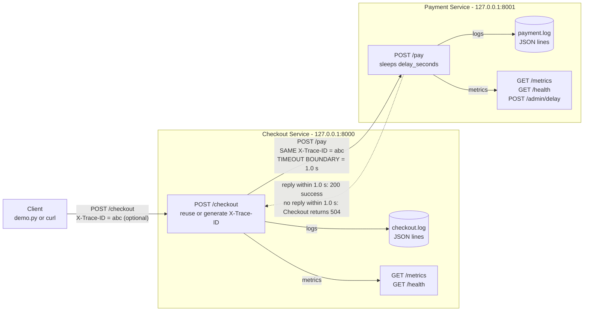
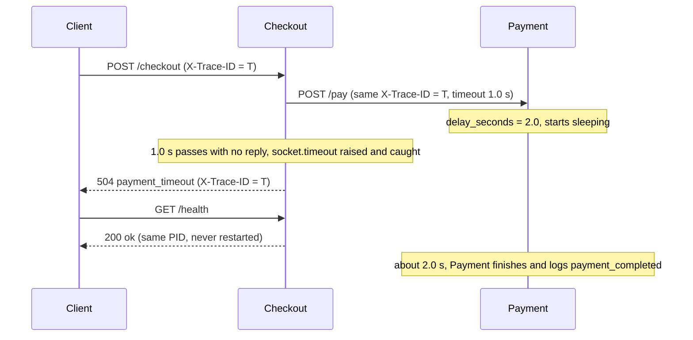

# Module 9: Fault Tolerance & Observability

## Overview

This project contains two small HTTP services that run as **separate OS processes**:

- **Checkout Service** (`:8000`): receives `POST /checkout` and calls Payment over real HTTP with a **1.0 s timeout**.
- **Payment Service** (`:8001`): processes `POST /pay` and supports a configurable **artificial delay** to simulate a slow dependency.

Every request carries one **trace ID** (`X-Trace-ID`) from the client through Checkout to Payment. Both services write **structured JSON-lines logs** and keep **in-memory metrics** (`GET /metrics`).

`demo.py` runs the whole experiment automatically:

| Phase | What happens | Result |
|---|---|---|
| 1. Success | Payment delay 0 s | Checkout returns `200`, the same trace ID appears in both services |
| 2. Failure | Payment delay **2.0 s** > Checkout timeout **1.0 s** | real HTTP timeout, Checkout returns **`504`**, `/health` still `200` |
| 3. Recovery | Payment delay set back to 0 s (Checkout untouched) | requests succeed, **error rate 50% → 20%**, **latency 1003 ms → 3 ms** |

The project uses **only the Python standard library**, with no Flask, Docker or Prometheus, so every line is easy to read and explain.

## Architecture



The failure scenario as a timeline (the timeout boundary is the 1.0 s Checkout waits on its socket):



## Observability

### Logs

Both services write one JSON object per line to stdout **and** to a log file (`evidence/*.log` in the demo, `logs/*.log` when run manually). Every entry has the same core fields:

| Field | Meaning |
|---|---|
| `timestamp` | UTC, microsecond precision, so both services' logs can be merged into one timeline |
| `service` | `checkout` or `payment` |
| `trace_id` | the request's `X-Trace-ID` (`null` for service lifecycle events) |
| `event` | what happened (see below) |
| `status` | `success` / `failure` / `null` (in progress) |
| `latency_ms` | elapsed time since the request arrived at *this* service |

Events logged:

- **Checkout:** `request_started` (with `trace_id_source` = `client` or `generated`), `payment_call_started`, `payment_response_received`, `payment_timeout`, `payment_unavailable`, `payment_error`, `request_completed` (with `http_status`, `reason`), `service_started`, `service_stopped`.
- **Payment:** `payment_started` (with `delay_seconds`), `payment_completed`, `payment_rejected`, `response_not_delivered`, `delay_changed`, `service_started`, `service_stopped`.

### Metrics

`GET /metrics` on each service returns flat JSON from [common/metrics.py](common/metrics.py):

| Metric | Checkout | Payment |
|---|---|---|
| `total_requests` | ✅ | ✅ |
| `success_count` | ✅ | ✅ |
| `failure_count` | ✅ | ✅ |
| `timeout_count` | ✅ (Payment timeouts) | n/a: Payment makes no outbound call |
| `error_rate` / `error_rate_percent` | `failure_count / total_requests` | same |
| `average_latency_ms`, `min_latency_ms`, `max_latency_ms`, `last_latency_ms` | ✅ | ✅ |
| `failures_by_reason` | e.g. `{"payment_timeout": 1}` | e.g. `{"missing_trace_id": 1}` |

Metrics are cumulative since the process started, so a restart would reset them. The fact that they keep counting through the failure and recovery phases is further proof that Checkout was never restarted.

### Trace ID

1. Checkout reads the incoming `X-Trace-ID` header. If it is absent, Checkout generates `uuid.uuid4()`.
2. Checkout logs every step with that ID and sends **the exact same value** in the `X-Trace-ID` header of its HTTP request to Payment ([checkout_service/app.py](checkout_service/app.py), `call_payment`).
3. Payment reads the header and logs it. **Payment never creates its own trace ID**: a `/pay` request without the header is rejected with `400 missing_trace_id`.
4. Payment echoes the ID in its JSON reply, and Checkout returns it in both the response body and the `X-Trace-ID` response header, so the client can quote it when reporting a problem.

### Latency

Each service measures its own latency with `time.perf_counter()`, starting when the request arrives and stopping just before the response is sent. Checkout's latency therefore includes the full network round trip to Payment, while Payment's latency includes its artificial delay. Values appear in the logs (`latency_ms`), in `/metrics`, and in the Checkout response body.

### How the timeout works

Checkout calls `urllib.request.urlopen(request, timeout=CHECKOUT_TIMEOUT_SECONDS)`. The timeout is applied to the socket, so when Payment sends no bytes for 1.0 s the blocking read raises `socket.timeout`. Checkout catches it, logs `payment_timeout`, records the failure in its metrics and returns **HTTP 504**. Nothing is faked: the measured failure latency (about 1003 ms) is always ≥ the timeout and < the 2000 ms Payment delay, and a test asserts exactly that. Because Checkout uses `ThreadingHTTPServer`, a slow request never blocks `/health` or other requests.

> **Important distinction:** a Checkout timeout means *Checkout stopped waiting*. It does **not** mean Payment crashed. In the demo, Payment keeps working and logs `payment_completed` about 1 s *after* Checkout gave up. In a real system that order would need reconciliation, for example by an idempotency key or `order_id`, because the client saw a 504 while the payment actually went through.

## Project Structure

```
.
├── README.md
├── requirements.txt          # no third-party dependencies (stdlib only)
├── .gitignore
├── demo.py                   # deterministic 3-phase demo, writes evidence/demo-output.txt
├── checkout_service/
│   ├── __init__.py
│   └── app.py                # POST /checkout, GET /health, GET /metrics; HTTP call + timeout handling
├── payment_service/
│   ├── __init__.py
│   └── app.py                # POST /pay, GET /health, GET /metrics, GET|POST /admin/delay
├── common/
│   ├── __init__.py
│   ├── logging_utils.py      # JSON-lines structured logger
│   ├── metrics.py            # thread-safe in-memory counters + latency
│   ├── http_utils.py         # JSON request/response helpers, X-Trace-ID header name
│   └── client.py             # used only by demo.py/tests: start processes, HTTP client, log reader
├── tests/
│   ├── __init__.py
│   └── test_system.py        # 29 automated tests against the real running services
└── evidence/
    ├── demo-output.txt       # full output of `python3 demo.py`
    ├── test-output.txt       # full output of the test suite
    ├── checkout.log          # Checkout's JSON logs from that demo run
    └── payment.log           # Payment's JSON logs from that demo run
```

The logging and metrics code lives in `common/` rather than being copied into each service, so there is one implementation to read and test. The two services still share **no runtime state**: each runs as its own process with its own logger, metrics and port, and they communicate only over HTTP.

## Requirements

- **Python 3.9 or newer** (developed and verified on Python 3.9.6, macOS).
- **No third-party packages.** Only the standard library is used (`http.server`, `urllib.request`, `json`, `threading`, `unittest`). `requirements.txt` is intentionally empty apart from comments.
- `curl` is optional, for the manual commands below.

Configuration (environment variables, all optional):

| Variable | Default | Used by |
|---|---|---|
| `CHECKOUT_PORT` | `8000` | Checkout |
| `PAYMENT_URL` | `http://127.0.0.1:8001` | Checkout |
| `CHECKOUT_TIMEOUT_SECONDS` | `1.0` | Checkout |
| `CHECKOUT_LOG_FILE` | `logs/checkout.log` | Checkout |
| `PAYMENT_PORT` | `8001` | Payment |
| `PAYMENT_DELAY_SECONDS` | `0` | Payment (initial delay) |
| `PAYMENT_LOG_FILE` | `logs/payment.log` | Payment |

## How to Run

### 1. Setup

```bash
git clone https://github.com/Revati-sp/Distributed-systems-Assignment---Fault-Tolerance-Observability.git
cd Distributed-systems-Assignment---Fault-Tolerance-Observability

python3 -m venv .venv
source .venv/bin/activate
pip install -r requirements.txt   # installs nothing; stdlib only
```

### 2. Run the automated demo (recommended)

```bash
python3 demo.py
```

`demo.py` starts Payment and Checkout as two separate processes on ports 8000/8001, runs all three phases, prints a PASS/FAIL summary, stops both services and saves the evidence into `evidence/`. It exits with code 0 only if every check passes. Make sure nothing else is using ports 8000/8001, or use `python3 demo.py --checkout-port 9000 --payment-port 9001`.

### 3. Run the services manually (two terminals)

Terminal 1, Payment:

```bash
python3 -m payment_service.app
```

Terminal 2, Checkout:

```bash
python3 -m checkout_service.app
```

Terminal 3, try it:

```bash
# health
curl -s localhost:8000/health
curl -s localhost:8001/health

# 1) success
curl -s -X POST localhost:8000/checkout -H 'Content-Type: application/json' \
     -d '{"order_id":"order-123","amount":49.99}'

# 2) failure: make Payment slower than Checkout's 1.0 s timeout (lab-only admin endpoint)
curl -s -X POST localhost:8001/admin/delay -H 'Content-Type: application/json' -d '{"delay_seconds":2}'
curl -s -i -X POST localhost:8000/checkout -H 'Content-Type: application/json' \
     -H 'X-Trace-ID: my-failed-request' -d '{"order_id":"order-124","amount":49.99}'
curl -s localhost:8000/health          # Checkout is still alive
grep my-failed-request logs/*.log      # follow the failed request across both services

# 3) recovery: remove the delay (Checkout is not touched)
curl -s -X POST localhost:8001/admin/delay -H 'Content-Type: application/json' -d '{"delay_seconds":0}'
curl -s -X POST localhost:8000/checkout -H 'Content-Type: application/json' \
     -d '{"order_id":"order-125","amount":49.99}'
curl -s localhost:8000/metrics
```

Stop each service with `Ctrl+C`.

> **`POST /admin/delay` exists only for this lab demonstration.** It lets the demo switch Payment between normal and slow mode at runtime without editing code or restarting anything. A real payment service would never expose it. Alternatively, start Payment with `PAYMENT_DELAY_SECONDS=2 python3 -m payment_service.app`.

### 4. Run the tests

```bash
python3 -m unittest discover -s tests -t . -v
```

## Successful Request

Actual output from `python3 demo.py` ([evidence/demo-output.txt](evidence/demo-output.txt)). No `X-Trace-ID` was sent, so Checkout generated one, and Payment received and echoed the same ID:

```text
==================================================
PHASE 1: SUCCESSFUL REQUEST
==================================================
Payment delay: NORMAL (0.0 s)
Request: POST /checkout {"order_id": "order-1001", "amount": 49.99}  (no X-Trace-ID sent, so Checkout generates one)

Trace ID: 7a500e08-eee2-4f12-b4a6-ff50104d5f79

Checkout -> Payment

Checkout status: SUCCESS (HTTP 200)
Payment status: SUCCESS (payment_id=pay-922b5bf8a83a)
Checkout latency: 5.30 ms
Trace ID echoed by Payment: 7a500e08-eee2-4f12-b4a6-ff50104d5f79
Trace ID shared across services: YES (7a500e08-eee2-4f12-b4a6-ff50104d5f79)

Log entries for trace 7a500e08-eee2-4f12-b4a6-ff50104d5f79 (both services, merged by timestamp):
  CHECKOUT 2026-11-14T05:19:07.302285Z trace_id=7a500e08-eee2-4f12-b4a6-ff50104d5f79 event=request_started
  CHECKOUT 2026-11-14T05:19:07.302390Z trace_id=7a500e08-eee2-4f12-b4a6-ff50104d5f79 event=payment_call_started timeout_seconds=1.0
  PAYMENT  2026-11-14T05:19:07.307062Z trace_id=7a500e08-eee2-4f12-b4a6-ff50104d5f79 event=payment_started delay_seconds=0.0
  PAYMENT  2026-11-14T05:19:07.307189Z trace_id=7a500e08-eee2-4f12-b4a6-ff50104d5f79 event=payment_completed status=success latency_ms=0.14 delay_seconds=0.0
  CHECKOUT 2026-11-14T05:19:07.307445Z trace_id=7a500e08-eee2-4f12-b4a6-ff50104d5f79 event=payment_response_received status=success latency_ms=5.19
  CHECKOUT 2026-11-14T05:19:07.307552Z trace_id=7a500e08-eee2-4f12-b4a6-ff50104d5f79 event=request_completed status=success latency_ms=5.3 http_status=200

Metrics after PHASE 1:
  Checkout GET /metrics: {"service": "checkout", "total_requests": 1, "success_count": 1, "failure_count": 0, "timeout_count": 0, "error_rate": 0.0, "error_rate_percent": 0.0, "average_latency_ms": 5.3, "min_latency_ms": 5.3, "max_latency_ms": 5.3, "last_latency_ms": 5.3, "failures_by_reason": {}}
  Payment  GET /metrics: {"service": "payment", "total_requests": 1, "success_count": 1, "failure_count": 0, "error_rate": 0.0, "error_rate_percent": 0.0, "average_latency_ms": 0.14, "min_latency_ms": 0.14, "max_latency_ms": 0.14, "last_latency_ms": 0.14, "failures_by_reason": {}}
```

## Failure Test

**Setup:** Payment delay **2.0 s** > Checkout timeout **1.0 s**. The delay is switched on at runtime through `POST /admin/delay`; Checkout is not modified. This time the client supplies its own trace ID, which Checkout preserves.

```text
==================================================
PHASE 2: PAYMENT DELAY / TIMEOUT
==================================================
Payment delay enabled: 2.0 seconds   (POST http://127.0.0.1:8001/admin/delay)
Checkout timeout: 1.0 seconds
Payment delay > Checkout timeout: YES

Trace ID: failure-83aa3689-8213-4493-bc43-f479a0a2fb1f   (supplied by the client in X-Trace-ID)

Checkout -> Payment
Payment begins processing...   (payment.log: event=payment_started delay_seconds=2.0)
Checkout timeout detected.     (Checkout error=payment_timeout)

Checkout response: TIMEOUT
HTTP status: 504
Checkout message: Checkout stopped waiting for Payment after 1.0s. Payment may still finish the request later.
Trace ID preserved in response: YES
Checkout latency: 1003.58 ms  (>= 1000 ms timeout and < 2000 ms Payment delay: Checkout really waited, then gave up) YES

GET /health -> HTTP 200 {"status": "ok", "service": "checkout", "pid": 573, "started_at": "2026-11-14T05:19:07.295797Z", "uptime_seconds": 1.024, "payment_url": "http://127.0.0.1:8001", "payment_timeout_seconds": 1.0}
Checkout service still running: YES  (same pid 573, never restarted)
```

What this proves:

- **Checkout detected a real timeout.** It waited 1003.58 ms, which is longer than the 1.0 s timeout but shorter than Payment's 2.0 s delay. It then returned **HTTP 504** with `error: payment_timeout`.
- **Checkout stayed alive.** Right after the timeout, `GET /health` returned `200` from the **same PID (573)** that served Phase 1.
- **Failure and timeout counters increased** (next section): `failure_count 0 → 1`, `timeout_count 0 → 1`.
- **Payment was slow, not crashed.** The demo then waits, by polling Payment's log rather than sleeping, until Payment finishes on its own:

```text
Waiting for Payment to finish the slow request (Payment is slow, not crashed)...
Payment finished the request AFTER Checkout gave up: YES (payment latency 2005.29 ms)
=> Checkout stopped waiting because its timeout expired; Payment was intentionally slow
   and still completed. The client got a 504, so the outcome must be reconciled later
   (e.g. by order_id); the timeout is NOT proof that Payment crashed.
```

## Trace Correlation

The failed request's trace ID is **`failure-83aa3689-8213-4493-bc43-f479a0a2fb1f`**. These are the actual entries from **both** log files, merged by timestamp:

```text
CROSS-SERVICE TRACE for the failed request (grep failure-83aa3689-8213-4493-bc43-f479a0a2fb1f evidence/*.log):
  CHECKOUT 2026-11-14T05:19:07.310916Z trace_id=failure-83aa3689-8213-4493-bc43-f479a0a2fb1f event=request_started
  CHECKOUT 2026-11-14T05:19:07.311034Z trace_id=failure-83aa3689-8213-4493-bc43-f479a0a2fb1f event=payment_call_started timeout_seconds=1.0
  PAYMENT  2026-11-14T05:19:07.311475Z trace_id=failure-83aa3689-8213-4493-bc43-f479a0a2fb1f event=payment_started delay_seconds=2.0
  CHECKOUT 2026-11-14T05:19:08.313031Z trace_id=failure-83aa3689-8213-4493-bc43-f479a0a2fb1f event=payment_timeout status=failure latency_ms=1002.07 timeout_seconds=1.0
  CHECKOUT 2026-11-14T05:19:08.314570Z trace_id=failure-83aa3689-8213-4493-bc43-f479a0a2fb1f event=request_completed status=failure latency_ms=1003.58 http_status=504 reason=payment_timeout
  PAYMENT  2026-11-14T05:19:09.316804Z trace_id=failure-83aa3689-8213-4493-bc43-f479a0a2fb1f event=payment_completed status=success latency_ms=2005.29 delay_seconds=2.0
Same trace ID found in Checkout AND Payment logs: YES
```

The raw JSON lines, as written by each service ([evidence/checkout.log](evidence/checkout.log), [evidence/payment.log](evidence/payment.log)):

```json
{"timestamp": "2026-11-14T05:19:07.310916Z", "service": "checkout", "trace_id": "failure-83aa3689-8213-4493-bc43-f479a0a2fb1f", "event": "request_started", "status": null, "latency_ms": null, "trace_id_source": "client"}
{"timestamp": "2026-11-14T05:19:07.311034Z", "service": "checkout", "trace_id": "failure-83aa3689-8213-4493-bc43-f479a0a2fb1f", "event": "payment_call_started", "status": null, "latency_ms": null, "order_id": "order-1002", "payment_url": "http://127.0.0.1:8001", "timeout_seconds": 1.0}
{"timestamp": "2026-11-14T05:19:07.311475Z", "service": "payment", "trace_id": "failure-83aa3689-8213-4493-bc43-f479a0a2fb1f", "event": "payment_started", "status": null, "latency_ms": null, "order_id": "order-1002", "amount": 49.99, "delay_seconds": 2.0}
{"timestamp": "2026-11-14T05:19:08.313031Z", "service": "checkout", "trace_id": "failure-83aa3689-8213-4493-bc43-f479a0a2fb1f", "event": "payment_timeout", "status": "failure", "latency_ms": 1002.07, "timeout_seconds": 1.0, "detail": "no response from Payment within 1.0s"}
{"timestamp": "2026-11-14T05:19:08.314570Z", "service": "checkout", "trace_id": "failure-83aa3689-8213-4493-bc43-f479a0a2fb1f", "event": "request_completed", "status": "failure", "latency_ms": 1003.58, "http_status": 504, "reason": "payment_timeout"}
{"timestamp": "2026-11-14T05:19:09.316804Z", "service": "payment", "trace_id": "failure-83aa3689-8213-4493-bc43-f479a0a2fb1f", "event": "payment_completed", "status": "success", "latency_ms": 2005.29, "order_id": "order-1002", "payment_id": "pay-63d57ff7372e", "delay_seconds": 2.0}
```

**Searching for this trace ID allows the failed request to be followed across Checkout and Payment.** Running `grep failure-83aa3689-8213-4493-bc43-f479a0a2fb1f evidence/*.log` gives the whole story from two independent processes:

1. Checkout received the request and called Payment with a 1.0 s timeout.
2. Payment **did** receive it, with the same ID, and started a 2.0 s operation.
3. Checkout gave up after about 1002 ms and answered the client with 504.
4. Payment finished successfully about 1 s later, after nobody was waiting any more.

Without the shared ID, the Checkout timeout and the slow Payment entry would be unrelated lines in two different files.

## Metrics During Failure

Actual `/metrics` output immediately after the failed request:

```text
Metrics immediately after the failure:
  Checkout GET /metrics: {"service": "checkout", "total_requests": 2, "success_count": 1, "failure_count": 1, "timeout_count": 1, "error_rate": 0.5, "error_rate_percent": 50.0, "average_latency_ms": 504.44, "min_latency_ms": 5.3, "max_latency_ms": 1003.58, "last_latency_ms": 1003.58, "failures_by_reason": {"payment_timeout": 1}}
  Payment  GET /metrics: {"service": "payment", "total_requests": 1, "success_count": 1, "failure_count": 0, "error_rate": 0.0, "error_rate_percent": 0.0, "average_latency_ms": 0.14, "min_latency_ms": 0.14, "max_latency_ms": 0.14, "last_latency_ms": 0.14, "failures_by_reason": {}}
  Checkout failure_count: 0 -> 1   timeout_count: 0 -> 1   error_rate: 0.0% -> 50.0%
```

| Checkout metric | Before failure | After failure |
|---|---|---|
| `total_requests` | 1 | 2 |
| `success_count` | 1 | 1 |
| `failure_count` | 0 | **1** |
| `timeout_count` | 0 | **1** |
| `error_rate` | 0.0% | **50.0%** |
| `max_latency_ms` | 5.3 | **1003.58** |

Payment still shows only 1 completed request at this moment because the slow one is still sleeping inside Payment. It is counted once it finishes, as Payment's metrics after recovery show (5 requests, max latency 2005.29 ms).

## Recovery

The delay is removed with `POST /admin/delay {"delay_seconds": 0}`. **Checkout is not touched, reconfigured or restarted.**

```text
==================================================
PHASE 3: RECOVERY
==================================================
Payment delay removed.   (POST /admin/delay {"delay_seconds": 0} -> 0.0 s)
Checkout was not changed, reconfigured or restarted.

Recovery request 1/3
  Trace ID: 4890a018-c59d-4f1a-98e7-fa0d2586586d
  Checkout -> Payment
  Checkout status: SUCCESS (HTTP 200)
  Payment status: SUCCESS
  Checkout latency: 5.09 ms
  Log entries for this trace:
  CHECKOUT 2026-11-14T05:19:09.335293Z trace_id=4890a018-c59d-4f1a-98e7-fa0d2586586d event=request_started
  CHECKOUT 2026-11-14T05:19:09.335913Z trace_id=4890a018-c59d-4f1a-98e7-fa0d2586586d event=payment_call_started timeout_seconds=1.0
  PAYMENT  2026-11-14T05:19:09.337894Z trace_id=4890a018-c59d-4f1a-98e7-fa0d2586586d event=payment_started delay_seconds=0.0
  PAYMENT  2026-11-14T05:19:09.338577Z trace_id=4890a018-c59d-4f1a-98e7-fa0d2586586d event=payment_completed status=success latency_ms=0.71 delay_seconds=0.0
  CHECKOUT 2026-11-14T05:19:09.339781Z trace_id=4890a018-c59d-4f1a-98e7-fa0d2586586d event=payment_response_received status=success latency_ms=4.58
  CHECKOUT 2026-11-14T05:19:09.340297Z trace_id=4890a018-c59d-4f1a-98e7-fa0d2586586d event=request_completed status=success latency_ms=5.09 http_status=200
Recovery request 2/3
  Trace ID: ec4bb984-bf25-4182-8e55-e54c708c99ff
  Checkout -> Payment
  Checkout status: SUCCESS (HTTP 200)
  Payment status: SUCCESS
  Checkout latency: 3.04 ms
Recovery request 3/3
  Trace ID: 33382875-ee0a-4b06-92ed-99f1f8b481f5
  Checkout -> Payment
  Checkout status: SUCCESS (HTTP 200)
  Payment status: SUCCESS
  Checkout latency: 1.52 ms

Checkout service still running: YES  (same pid 573, uptime 2.1 s)
Checkout service_started events in checkout.log: 1 (started once, never restarted)

Metrics after recovery:
  Checkout GET /metrics: {"service": "checkout", "total_requests": 5, "success_count": 4, "failure_count": 1, "timeout_count": 1, "error_rate": 0.2, "error_rate_percent": 20.0, "average_latency_ms": 203.7, "min_latency_ms": 1.52, "max_latency_ms": 1003.58, "last_latency_ms": 1.52, "failures_by_reason": {"payment_timeout": 1}}
  Payment  GET /metrics: {"service": "payment", "total_requests": 5, "success_count": 5, "failure_count": 0, "error_rate": 0.0, "error_rate_percent": 0.0, "average_latency_ms": 401.34, "min_latency_ms": 0.14, "max_latency_ms": 2005.29, "last_latency_ms": 0.16, "failures_by_reason": {}}
```

Checkout was never restarted. It is the **same PID (573)** in every phase, `checkout.log` contains exactly **one** `service_started` event, and its counters kept accumulating (a restart would have reset them to 0).

### Error rate decreased (computed from real `/metrics` counters)

```text
==================================================
ERROR RATE (from Checkout /metrics counters)
==================================================
Before failure:    0.0%  (0 failed / 1 total)
After failure:    50.0%  (1 failed / 2 total)
After recovery:   20.0%  (1 failed / 5 total)

ERROR RATE DECREASED: YES
```

### Latency returned to normal

```text
==================================================
LATENCY (measured inside Checkout, per request)
==================================================
Normal latency:      5.30 ms
Failure latency:  1003.58 ms   (~ the 1000 ms timeout)
Recovery latency:    3.22 ms   (average of 3 requests: 5.09, 3.04, 1.52)
Rule: recovery average < 50% of the timeout (500 ms) and < 50% of the failure latency

LATENCY RETURNED TO NORMAL RANGE: YES
```

Exact millisecond values vary between machines and runs, so the demo and tests check a deliberately generous **relationship** instead of exact numbers. The failure latency must be at least the timeout and less than the Payment delay. Recovery latency must be below half the timeout and below half the failure latency.

## Evidence

All files in `evidence/` come from one real run of `python3 demo.py` and one real run of the test suite. Nothing was edited by hand.

| File | Contents |
|---|---|
| [evidence/demo-output.txt](evidence/demo-output.txt) | Complete demo output: all 3 phases, metrics, error-rate and latency comparisons, and a 24-item PASS/FAIL summary (`RESULT: ALL CHECKS PASSED (24/24 checks passed)`) |
| [evidence/checkout.log](evidence/checkout.log) | Checkout's JSON-lines log for that run (22 lines, one `service_started`, one `service_stopped`) |
| [evidence/payment.log](evidence/payment.log) | Payment's JSON-lines log for that run (15 lines, including the three `delay_changed` events) |
| [evidence/test-output.txt](evidence/test-output.txt) | Verbose output of `python3 -m unittest discover -s tests -t . -v` |

Run `python3 demo.py` again to regenerate all three demo files. Trace IDs, PIDs and timings will differ, but the logical result is the same every run.

## Automated Tests

`tests/test_system.py` starts the **real** services as separate processes on free ports, with log files in a temporary directory, and talks to them over HTTP. Synchronisation uses health-check and log polling with deadlines rather than fixed sleeps, and timing assertions use generous bounds.

| # | Requirement | Test |
|---|---|---|
| 1 | Checkout health works | `test_01_checkout_health` |
| 2 | Payment health works | `test_02_payment_health` (+ `test_02b`: separate PIDs) |
| 3 | Normal Payment request succeeds | `test_03_payment_request_succeeds` |
| 4 | Checkout succeeds normally | `test_04_checkout_request_succeeds` |
| 5 | Trace ID generated when absent | `test_05_trace_id_generated_when_absent` |
| 6 | Existing trace ID preserved | `test_06_existing_trace_id_preserved` |
| 7 | Checkout forwards same trace ID to Payment | `test_07_checkout_forwards_same_trace_id_to_payment` |
| 8 | Logs contain trace ID | `test_08_request_logs_contain_trace_id` |
| 9 | Metrics count total requests | `test_09_metrics_count_total_requests` |
| 10 | Success counter increments | `test_10_success_counter_increments_and_latency_recorded` |
| 11 | Payment delay can be enabled | `test_11_payment_delay_can_be_enabled` |
| 12 | Delay exceeds Checkout timeout | `test_12_payment_delay_exceeds_checkout_timeout` |
| 13 | Checkout detects real timeout | `test_13_checkout_detects_real_payment_timeout` |
| 14 | Timeout returns expected status | `test_14_timeout_returns_504` |
| 15 | Failure counter increments | `test_15_failure_counter_increments` |
| 16 | Timeout counter increments | `test_16_timeout_counter_increments` |
| 17 | Checkout alive after timeout | `test_17_checkout_alive_after_timeout` |
| 18 | Failure trace ID in both services | `test_18_failure_trace_id_in_both_services` (+ `test_18b`: Payment finishes after Checkout gave up) |
| 19 | Payment delay can be removed | `test_19_payment_delay_can_be_removed` |
| 20 | Request succeeds after recovery | `test_20_requests_succeed_after_recovery` |
| 21 | Error rate decreases | `test_21_error_rate_decreases_after_recovery` |
| 22 | Latency returns to normal | `test_22_latency_returns_to_normal_range` |
| + | Extra edge cases | Payment rejects a missing trace ID; invalid checkout returns 400 with trace ID; invalid delay rejected; **Payment down returns 502 and Checkout stays healthy**; error-rate math unit test |

Actual output ([evidence/test-output.txt](evidence/test-output.txt)):

```text
test_01_checkout_health (tests.test_system.Test1NormalOperation) ... ok
test_02_payment_health (tests.test_system.Test1NormalOperation) ... ok
test_02b_services_are_separate_processes (tests.test_system.Test1NormalOperation) ... ok
test_03_payment_request_succeeds (tests.test_system.Test1NormalOperation) ... ok
test_04_checkout_request_succeeds (tests.test_system.Test1NormalOperation) ... ok
test_05_trace_id_generated_when_absent (tests.test_system.Test1NormalOperation) ... ok
test_06_existing_trace_id_preserved (tests.test_system.Test1NormalOperation) ... ok
test_07_checkout_forwards_same_trace_id_to_payment (tests.test_system.Test1NormalOperation) ... ok
test_08_request_logs_contain_trace_id (tests.test_system.Test1NormalOperation) ... ok
test_09_metrics_count_total_requests (tests.test_system.Test1NormalOperation) ... ok
test_10_success_counter_increments_and_latency_recorded (tests.test_system.Test1NormalOperation) ... ok
test_11_payment_delay_can_be_enabled (tests.test_system.Test2FailureAndRecovery) ... ok
test_12_payment_delay_exceeds_checkout_timeout (tests.test_system.Test2FailureAndRecovery) ... ok
test_13_checkout_detects_real_payment_timeout (tests.test_system.Test2FailureAndRecovery) ... ok
test_14_timeout_returns_504 (tests.test_system.Test2FailureAndRecovery) ... ok
test_15_failure_counter_increments (tests.test_system.Test2FailureAndRecovery) ... ok
test_16_timeout_counter_increments (tests.test_system.Test2FailureAndRecovery) ... ok
test_17_checkout_alive_after_timeout (tests.test_system.Test2FailureAndRecovery) ... ok
test_18_failure_trace_id_in_both_services (tests.test_system.Test2FailureAndRecovery) ... ok
test_18b_payment_finishes_after_checkout_gave_up (tests.test_system.Test2FailureAndRecovery) ... ok
test_19_payment_delay_can_be_removed (tests.test_system.Test2FailureAndRecovery) ... ok
test_20_requests_succeed_after_recovery (tests.test_system.Test2FailureAndRecovery) ... ok
test_21_error_rate_decreases_after_recovery (tests.test_system.Test2FailureAndRecovery) ... ok
test_22_latency_returns_to_normal_range (tests.test_system.Test2FailureAndRecovery) ... ok
test_checkout_survives_payment_being_down (tests.test_system.Test3EdgeCases)
Different failure mode: Payment unreachable -> 502, Checkout keeps running. ... ok
test_invalid_checkout_request_returns_400_with_trace (tests.test_system.Test3EdgeCases) ... ok
test_invalid_delay_rejected (tests.test_system.Test3EdgeCases) ... ok
test_payment_does_not_invent_trace_id (tests.test_system.Test3EdgeCases) ... ok
test_error_rate_math (tests.test_system.Test4MetricsUnit) ... ok

----------------------------------------------------------------------
Ran 29 tests in 2.378s

OK
```

## Reflection

**How do logs, traces, and metrics help diagnose failures in a distributed system?**

Logs show what happened inside each individual service, such as Checkout recording a `payment_timeout` event after waiting about 1002 ms. A shared trace ID connects those separate log entries across services, so searching one `X-Trace-ID` showed that Payment did receive the request and was still working when Checkout gave up. Metrics reveal system-wide patterns that single log lines cannot, such as the Checkout error rate jumping from 0% to 50% and then falling to 20% as recovery requests succeeded. Together, metrics tell us that something is wrong, the trace ID tells us where the request went, and logs tell us why it failed, which turns a vague "checkout is broken" report into a precise diagnosis of a slow Payment dependency.
